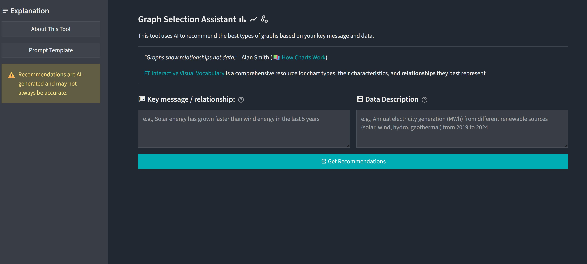

# Chart Type Assistant

This app us AI to give recommendations of chart type based on the message/relationship you want to highlight. 

*"Graphs show relationships not data."* - Alan Smith (📚 [How Charts Work](https://www.goodreads.com/book/show/63127668-how-charts-work))

 [FT Interactive Visual Vocabulary](https://ft-interactive.github.io/visual-vocabulary/) is a great resource providing overview of different chart types. 

## Features

- AI-powered graph type recommendations
- Gemini 3 (via OpenRouter) for fast, structured recommendations
- Integration with FT Visual Vocabulary chart taxonomy
- Explanations with axes, legends, and chart-specific rationale




## Setup

### Prerequisites

- Python 3.11+
- An OpenRouter API key ([get one here](https://openrouter.ai/))

### Installation

1. Clone the repository and enter the project directory:

```bash
cd graph-assistant
```

2. Install dependencies:

```bash
pip install -r requirements.txt
```

3. Configure your API key (choose one):

- Copy `.env.example` to `.env` and set `OPENROUTER_API_KEY`
- Set `OPENROUTER_API_KEY` in Streamlit secrets (`.streamlit/secrets.toml`)
- Enter the key directly in the app sidebar at runtime

### Run the app

```bash
streamlit run app.py
```

The app will open at [http://localhost:8501](http://localhost:8501).

## Web app (Next.js)

A Next.js replica of the Streamlit app lives in [`web/`](web/). It has the same inputs, prompt, model, tool schema and result cards, with a different visual style. Both apps read the chart vocabulary and icons from `graphs/`.

### Prerequisites

- Node.js 20.9+ (`web/.nvmrc` pins 22)

### Run it

```bash
cd web
cp .env.example .env.local   # then set OPENROUTER_API_KEY, or leave it unset to enter a key in the app
./run.sh                     # installs dependencies if needed, then starts the dev server
```

The app opens at [http://localhost:3000](http://localhost:3000). Use `./run.sh --prod` for a production build and server, and `PORT=4000 ./run.sh` to change the port. Without the script: `npm install && npm run dev`.

`npm run dev`, `build`, `test` and `typecheck` first copy `graphs/visual_vocabulary.json` and `graphs/icons/` into `web/` (`npm run sync-graphs`). Those copies are gitignored, so edit the files in `graphs/`.

### Checks

```bash
npm run lint
npm run typecheck
npm test
```

The prompt and tool-schema tests compare the TypeScript port with fixtures generated from `api_utils.py`. If you change the prompt, the tool schema or `graphs/visual_vocabulary.json`, regenerate them from the repository root:

```bash
python web/scripts/generate_parity_fixtures.py
```

### Layout

- `web/src/app/`: the page and the `POST /api/recommend` route handler, which calls OpenRouter on the server
- `web/src/server/`: prompt construction, OpenRouter client and vocabulary helpers (ports of `api_utils.py`)
- `web/src/views/` and `web/src/components/`: React UI with SCSS modules
- `web/src/shared/`: shared types, constants and utilities

## Usage

1. Enter the key message/relationship you want the chart to communicate.
2. Describe your dataset.
3. Click **Get Recommendations**.
4. Review 2-3 suggested chart types with implementation guidance.

## Project Structure

- `app.py`: Streamlit UI and user interaction flow
- `api_utils.py`: Prompt construction, OpenRouter API calls, response parsing
- `graphs/visual_vocabulary.json`: Chart taxonomy and metadata used for tool constraints
- `graphs/graphs/`: SVG icons shown with recommendations

## License

MIT License. See `LICENSE`.
